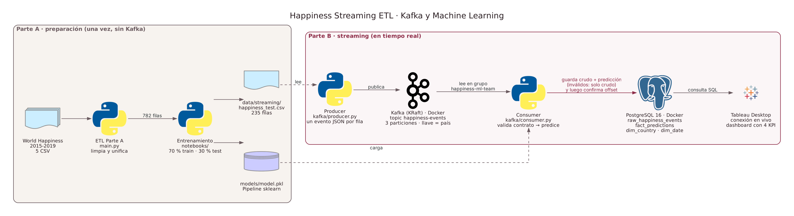
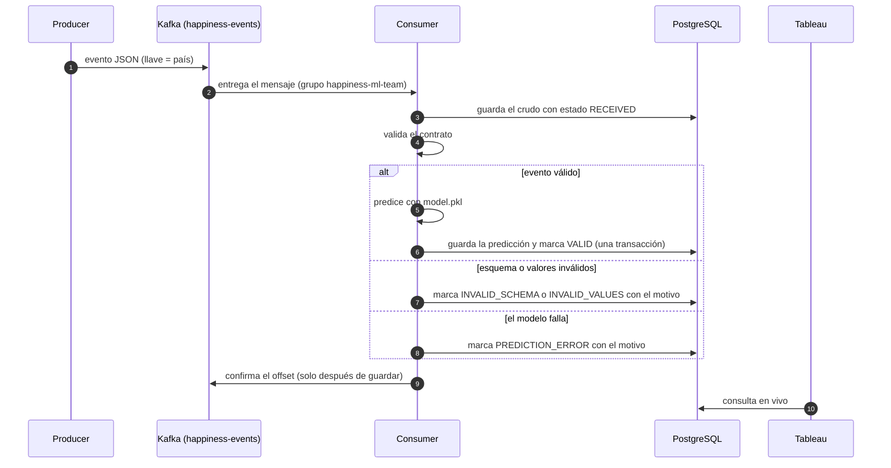
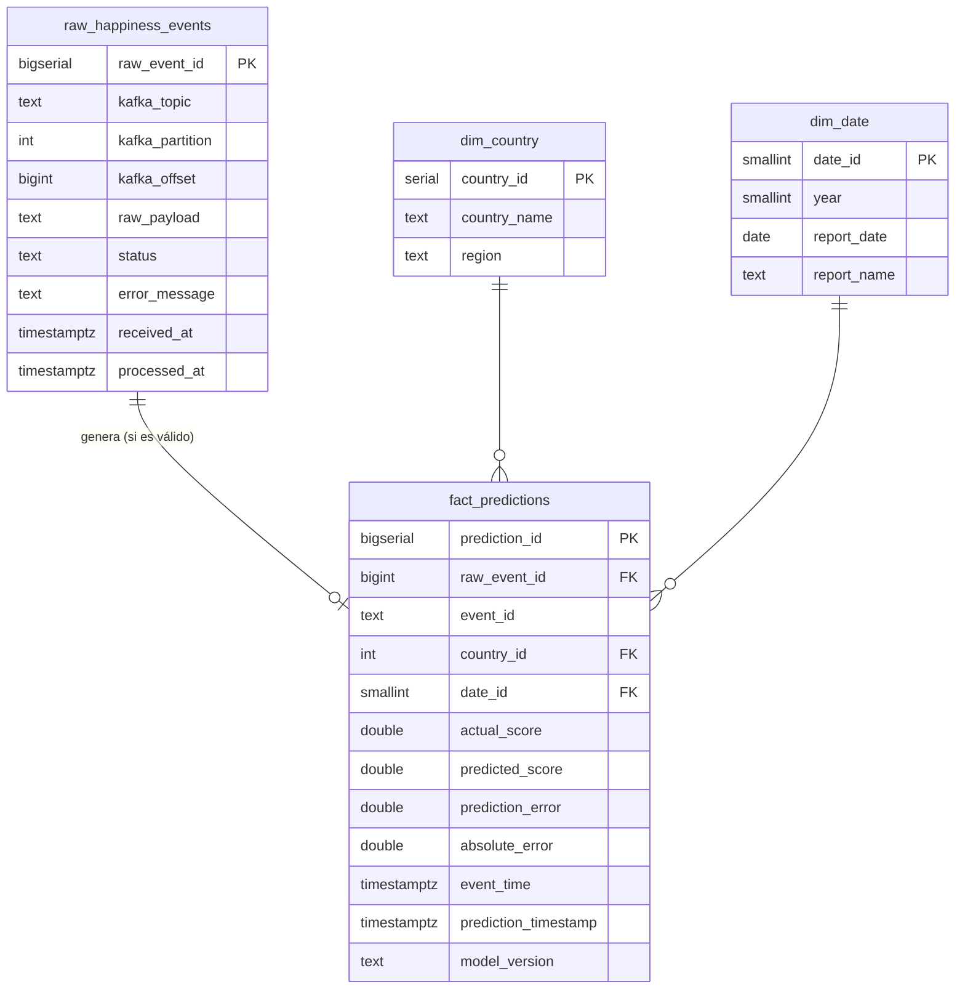
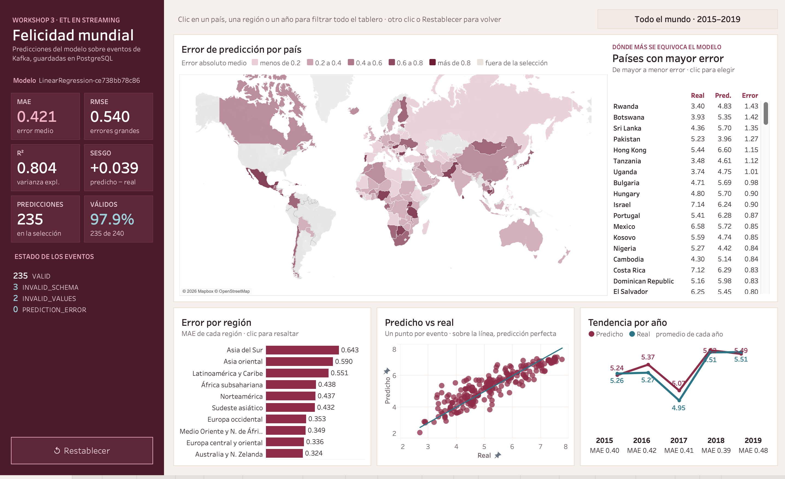
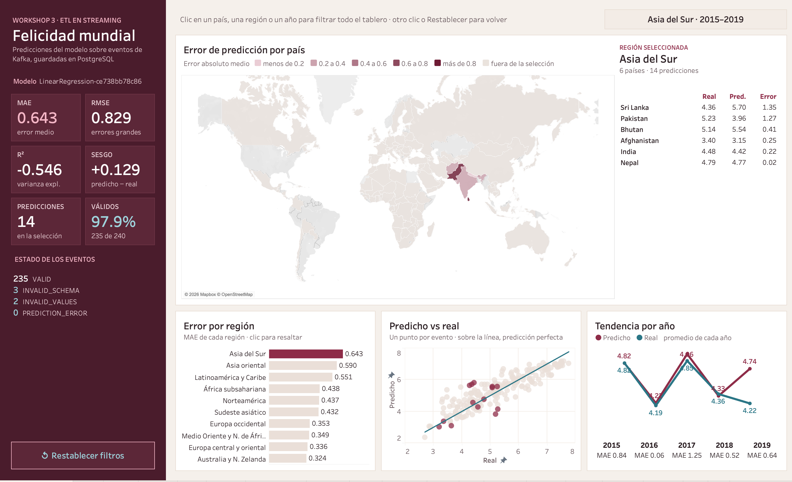
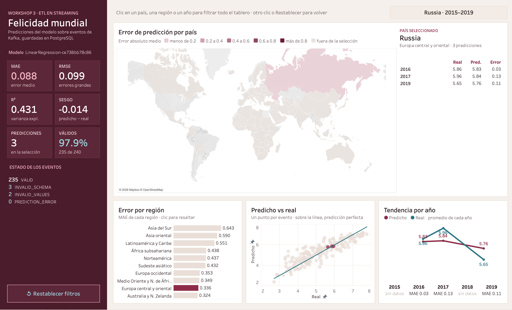

# Happiness Streaming ETL

Pipeline ETL en streaming con Apache Kafka y un modelo de regresión preentrenado que predice en tiempo real el puntaje de felicidad (World Happiness, datos 2015-2019).

Curso: ETL (G01) - Workshop-3, Universidad Autónoma de Occidente.

## Descripción del proyecto

El proyecto tiene dos partes:

- **Parte A (offline):** perfilar los cinco archivos anuales de World Happiness, limpiarlos y armonizarlos en un solo dataset, y entrenar un modelo de regresión guardado como `model.pkl`.
- **Parte B (streaming):** un producer de Kafka publica cada registro como un evento; un consumer lo valida, predice el puntaje y guarda los eventos crudos y las predicciones en una base de datos que alimenta el dashboard.

## Arquitectura



La imagen se genera con [`docs/diagrams/architecture.py`](docs/diagrams/architecture.py) (requiere la biblioteca `diagrams` y Graphviz, que no hacen falta para ejecutar el pipeline).

- **Parte A (una vez, sin Kafka):** el ETL limpia y unifica los cinco CSV; el notebook de entrenamiento divide el dataset, guarda el modelo y separa el 30 % de prueba, que es lo que se transmite.
- **Parte B (en tiempo real):** el producer publica cada fila de prueba como un evento JSON en Kafka; el consumer lo lee, lo valida contra el contrato, predice con `model.pkl` y guarda todo en PostgreSQL; Tableau consulta la base en vivo.
- **Docker** solo corre Kafka y PostgreSQL. El producer, el consumer y los notebooks son Python local.

Recorrido de un evento, incluido el caso de un evento dañado:



Como el offset se confirma después de guardar, si el consumer se cae a mitad de un evento Kafka se lo vuelve a entregar y no se pierde; la llave única `(topic, partition, offset)` del crudo evita guardarlo dos veces.

La Parte A es un paquete de Python (`src/happiness_etl/`) que ejecuta `main.py`:

```
data/raw/*.csv -> extract -> clean -> transform -> validate (compuerta de calidad) -> load -> data/processed/happiness_unified.csv
```

| Módulo | Responsabilidad |
|---|---|
| `config.py` | Rutas, años, nombres canónicos y mapa de columnas de cada año (única fuente de verdad) |
| `extract.py` | Leer los CSV originales tal como vienen |
| `clean.py` | Por año: nombres canónicos de columna, columna `year`, texto del país, tipos numéricos y duplicados exactos |
| `transform.py` | Entre años: unir, unificar nombres de país, interpolar valores faltantes y ordenar |
| `validate.py` | Compuerta de calidad antes de cargar y reconciliación después de cargar |
| `load.py` | Escritura atómica del CSV y lectura con tipos del dataset unificado |
| `contract.py` | Streaming: contrato del evento (armar y validar eventos) |
| `db.py` | Streaming: datos de conexión a PostgreSQL (entorno, `.env` o valores por defecto) |
| `inference.py` | Streaming: carga `model.pkl` y predice un evento |
| `storage.py` | Streaming: lo que el consumer escribe en PostgreSQL (crudo, estado y predicción) |

Los pasos intermedios se pasan en memoria; solo el dataset final ya validado se escribe en disco, porque los notebooks lo leen desde procesos separados. El archivo no se versiona: se regenera con `main.py`.

`notebooks/model_training.ipynb` divide ese dataset en entrenamiento (70 %) y prueba (30 %), guarda el modelo en `models/model.pkl` y escribe la parte de prueba en `data/streaming/happiness_test.csv`. Ese archivo, versionado, es lo que transmite el producer de Kafka, para que las métricas del dashboard se calculen sobre datos que el modelo no vio.

## Decisiones de limpieza de datos

El perfilado de calidad está en [`notebooks/profiling.ipynb`](notebooks/profiling.ipynb) . Decisiones principales:

| Hallazgo | Decisión |
|---|---|
| Un mismo concepto tiene hasta tres nombres de columna según el año | Se asigna a cada año los nombres canónicos (`config.COLUMN_MAP_BY_YEAR`) |
| Los archivos no traen columna de año | Se agrega `year` a partir del archivo de origen |
| Columnas que no se usan: rankings, `Region`, error estándar, intervalos de confianza, *whiskers* y `Dystopia Residual` | No pasan al dataset unificado. El ranking y el residual dependen del puntaje, así que usarlos sería fuga del target. `Region` (solo 2015-2016) se aprovecha como atributo de `dim_country` en la base de datos |
| Un único valor faltante: `corruption` de United Arab Emirates en 2018 | Interpolación lineal dentro del país (promedio de 2017 y 2019, 0.253). Solo entre años observados, sin extrapolar; queda registrado como aviso en el log |
| Seis países se escriben distinto según el año (p. ej. `Trinidad & Tobago`) | Se usa el nombre que aparece en más años (`config.COUNTRY_NAME_MAP`): 170 nombres pasan a ser 164 países |
| Un cero por variable y año, y 102 outliers según IQR | Se conservan: los ceros son el mínimo de cada escala y los outliers son valores plausibles, no errores |
| `family` y `health` cambian de escala entre años | No se modifica en la limpieza; se estudia en el EDA del modelo |

La compuerta de calidad (`validate.py`) detiene el pipeline antes de escribir si falla alguna regla y reporta todas las fallas juntas: esquema exacto, sin nulos, país no vacío, año entre 2015 y 2019, variables entre 0 y 3, puntaje entre 0 y 10 y par (país, año) único. Resultado: 782 filas, 164 países y ningún valor faltante.

## Decisiones de ingeniería de características

El análisis está en [`notebooks/eda.ipynb`](notebooks/eda.ipynb) y el entrenamiento en [`notebooks/model_training.ipynb`](notebooks/model_training.ipynb). Todo el EDA usa solo la parte de entrenamiento, para no mirar los datos de prueba antes de evaluar.

| Decisión | Motivo |
|---|---|
| División 70/30 con semilla fija (`random_state = 42`), estratificada por año | Proporción estándar para un dataset de este tamaño. Estratificar deja la misma proporción de cada año en entrenamiento (547 filas) y en prueba (235). |
| Variables: `gdp`, `family`, `health`, `freedom` y `corruption`, estandarizadas | Son las que explican el puntaje. Se estandarizan para que los coeficientes sean comparables entre sí. |
| `generosity` se descarta | Su coeficiente no es significativo (p = 0.45) y quitarla no cambia el error en validación cruzada (p = 0.53). Se prefiere el modelo más simple. El contrato del evento la sigue validando. |
| `year` entra como variable categórica (one-hot, 2015 como base) | Cada reporte anual tiene su propio nivel: en validación cruzada reduce el RMSE un 4.4 % (p = 0.023). El efecto no crece año a año (2016 sube, 2017-2019 bajan respecto a 2015), por eso no se usa como número. |
| No entran `country`, `region`, el ranking ni el puntaje | El ranking y el residual se calculan a partir del puntaje (sería fuga del target); el país no generaliza a datos nuevos. `actual_happiness_score` viaja en el evento solo para medir el error. |
| Modelo: regresión lineal (`LinearRegression`) | Un Random Forest no fue significativamente mejor (RMSE 0.515 frente a 0.530, p = 0.32) y la regresión es más fácil de explicar. Todo va en un `Pipeline` de scikit-learn, así el consumer aplica exactamente las mismas transformaciones. |
| Año fuera de 2015-2019 | Nunca se predice en silencio: el contrato lo rechaza como `INVALID_VALUES` y, como segunda barrera, el codificador usa `handle_unknown="error"` (sería `PREDICTION_ERROR`). |

Resultado sobre los 235 registros de prueba: **MAE 0.421, RMSE 0.540, R² 0.804 y sesgo +0.039**, frente a MAE 1.047 de predecir siempre el promedio del año. Son las mismas cifras que calcula el dashboard sobre lo que llegó por Kafka (`models/metrics.json`, `sql/kpis.sql`).

**Limitación.** La división es por fila (país y año), no por país: ninguna fila de prueba se usó para entrenar, pero el 96 % de ellas son de un país que tiene otros años en entrenamiento. Como los indicadores de un país cambian poco de un año a otro, el error medido es algo optimista para países que el modelo nunca vio (solo 5 países están únicamente en prueba). Una evaluación más exigente dividiría por país (todos los años de un país en el mismo grupo).

## Pipeline de Kafka y contrato del evento

```
data/streaming/happiness_test.csv -> producer -> topic happiness-events (3 particiones) -> consumer -> PostgreSQL
```

### Contrato del evento

Cada mensaje es un objeto JSON en UTF-8 con estos once campos. La llave del mensaje de Kafka es el país, así que todos los eventos de un país caen en la misma partición y conservan su orden.

```json
{
  "event_id": "3de398aa-28fb-401a-8bb3-98991bfc49b7",
  "country": "Namibia",
  "year": 2016,
  "gdp": 0.93287,
  "family": 0.70362,
  "health": 0.34745,
  "freedom": 0.48614,
  "generosity": 0.07795,
  "corruption": 0.10398,
  "actual_happiness_score": 4.574,
  "event_time": "2026-11-11T00:55:07.005Z"
}
```

| Campo | Tipo | Regla |
|---|---|---|
| `event_id` | texto | No vacío. Es un UUID al azar: identifica el evento de punta a punta (registro del producer, tabla cruda y tabla de hechos). |
| `country` | texto | No vacío. También es la llave del mensaje. |
| `year` | entero | Entre 2015 y 2019. No se aceptan `"2019"` ni `2019.5`. |
| `gdp`, `family`, `health`, `freedom`, `generosity`, `corruption` | número | Finito, entre 0 y 3. El máximo real en los datos es 2.096; el tope de 3 (`FEATURE_MAX` en `config.py`) frena valores absurdos que el modelo extrapolaría sin avisar. |
| `actual_happiness_score` | número | Entre 0 y 10. Es el puntaje real: viaja solo para medir el error, **nunca es una variable del modelo**. |
| `event_time` | texto | Fecha y hora ISO-8601: el momento en que el producer emitió el evento, en UTC. Si llega sin zona horaria (por ejemplo `2026-10-30T15:30:00`) se interpreta como UTC. |

El contrato vive en un solo módulo, [`src/happiness_etl/contract.py`](src/happiness_etl/contract.py): el producer arma los eventos con `build_event` y el consumer valida cada mensaje con `validate_event`. Los rangos son los mismos de la compuerta de calidad de la Parte A (salen de `config.py`), así que el streaming acepta exactamente lo que el ETL dio por limpio.

`validate_event` nunca lanza una excepción por el contenido de un mensaje: devuelve un estado y **todos** los motivos encontrados, que se guardan en `error_message`.

| Estado | Cuándo | Ejemplos |
|---|---|---|
| `VALID` | Cumple el contrato | |
| `INVALID_SCHEMA` | El mensaje no se puede interpretar | No es JSON o no es un objeto, falta un campo, texto en un campo numérico, `year` decimal, `event_time` que no es una fecha |
| `INVALID_VALUES` | La forma es correcta pero un valor está fuera de rango | Año 2020, variable negativa o mayor que 3, puntaje 11, `NaN` |
| `PREDICTION_ERROR` | El evento era válido pero el modelo falló | Lo asigna el consumer, con el error del modelo como motivo |

Si hay problemas de esquema no se evalúan los rangos. Los campos que sobran se ignoran: el mensaje original queda completo en la tabla cruda.

### Producer

[`kafka/producer.py`](kafka/producer.py) lee el conjunto de prueba (235 registros que el modelo no vio), arma un evento por registro y los publica uno por uno.

| Opción | Por defecto | Qué hace |
|---|---|---|
| `--delay` | `0.3` | Segundos de pausa entre eventos (simula la llegada en el tiempo; los 235 tardan poco más de un minuto). |
| `--limit N` | todos | Envía solo los primeros N registros. |
| `--with-invalid` | no | Intercala 5 eventos dañados a propósito para mostrar la validación. |
| `--seed` | `42` | Semilla del orden de envío. |

Decisiones:

- **Orden mezclado y reproducible.** Los registros se mezclan con una semilla fija para que lleguen países y años variados, como en un flujo real, y siempre en el mismo orden.
- **Entrega confirmada.** El producer es idempotente (`enable.idempotence`): el broker confirma cada evento y descarta los duplicados de un reintento. Se espera la confirmación de cada evento antes de enviar el siguiente y se registra en qué partición y offset quedó.
- **Aviso contra duplicados.** Antes de enviar, el producer cuenta los mensajes que ya hay en el topic. Si hay alguno, avisa (sin bloquear) que reenviar duplicaría las predicciones y señala `scripts/reset_demo.py`.
- **Fallas claras.** Si Kafka no responde, el topic no existe o un evento no se puede entregar, el envío se detiene con un mensaje y código de salida 1 (130 si se interrumpe con Ctrl+C).
- **Eventos dañados para la demostración.** Los datos de prueba están limpios, así que sin `--with-invalid` nunca llegaría un evento inválido. Con esa opción el resultado es siempre el mismo: 240 mensajes, de los cuales 235 son `VALID`, 3 `INVALID_SCHEMA` (falta `health`, texto en `gdp`, JSON cortado) y 2 `INVALID_VALUES` (año 2020, `gdp` negativo).

### Consumer

[`kafka/consumer.py`](kafka/consumer.py) pertenece al grupo `happiness-ml-team` y atiende los mensajes uno por uno:

1. **Guarda el mensaje crudo** en `raw_happiness_events` con estado `RECEIVED`, antes de interpretarlo.
2. **Valida el contrato.** Si no lo cumple, marca el crudo como `INVALID_SCHEMA` o `INVALID_VALUES` con todos los motivos y pasa al siguiente.
3. **Predice** con `models/model.pkl`. La fila se arma con las columnas que el Pipeline guardó al entrenarse, en el mismo orden; el preprocesamiento va dentro del Pipeline. Si el modelo falla, marca `PREDICTION_ERROR`.
4. **Guarda la predicción** en `fact_predictions` y marca el crudo como `VALID`, en una sola transacción.
5. **Confirma el offset** en Kafka, solo después de que la base guardó todo.

Decisiones:

- **Un evento malo no detiene nada.** Se guarda, se marca y se omite de la predicción. Esto incluye mensajes que ni siquiera son texto: como la columna `raw_payload` es de texto, los bytes que no son UTF-8 y los caracteres nulos se guardan como `�` y queda anotado en `error_message`. Un mensaje de texto se guarda idéntico.
- **Ni pérdidas ni duplicados.** El offset se confirma a mano y al final. Si el consumer cae a mitad de un evento, Kafka lo vuelve a entregar: si el crudo ya estaba cerrado se omite (lo identifica la terna topic, partición, offset) y si quedó en `RECEIVED` se termina de procesar.
- **Una falla de la infraestructura sí lo detiene.** Si PostgreSQL o Kafka dejan de responder, termina con un mensaje y código de salida 1. Al volver a ejecutarlo continúa donde iba.
- **Mismo tratamiento del país que en el entrenamiento.** Antes de buscarlo en `dim_country` se le quitan los espacios sobrantes y se unifican las variantes (`Trinidad & Tobago` es `Trinidad and Tobago`). Un país desconocido se agrega con región vacía.
- **`model_version`** es el tipo de modelo más una huella del archivo (`LinearRegression-ce738bb78c86`): si se reentrena cambia sola, y cada predicción dice qué modelo exacto la produjo.
- **Lee desde el inicio del topic** (`auto.offset.reset=earliest`): da igual si arranca antes o después del producer.
- **Cierre limpio.** Escucha hasta Ctrl+C: termina el evento en curso, sale del grupo y muestra el resumen por estado. Con `--idle-timeout N` termina solo tras N segundos sin mensajes.

Comprobado contra Kafka y PostgreSQL reales: con `--with-invalid` quedan 240 eventos crudos (235 `VALID`, 3 `INVALID_SCHEMA`, 2 `INVALID_VALUES`) y 235 predicciones, y el error calculado en SQL coincide con el del entrenamiento (MAE 0.4212, RMSE 0.5403). Matar el consumer, apagar PostgreSQL o apagar Kafka a mitad de la corrida y volver a arrancar da el mismo resultado, sin eventos perdidos ni repetidos. La predicción se guarda unos 20 ms después de emitido el evento.

### Reinicio de la demostración

Kafka y PostgreSQL conservan sus datos entre corridas, y cada corrida del producer genera `event_id` nuevos: si se ejecuta dos veces, las predicciones se duplican. [`scripts/reset_demo.py`](scripts/reset_demo.py) deja todo en cero en un solo paso: vacía `raw_happiness_events` y `fact_predictions` (las dimensiones no se tocan), borra el consumer group `happiness-ml-team` y recrea el topic. Las tres cosas van juntas porque, si se recreara el topic sin vaciar las tablas, los offsets volverían a empezar en 0 y chocarían con los ya guardados. Se niega a correr si el consumer sigue activo y no borra volúmenes de Docker.

## Esquema de la base de datos

PostgreSQL con un esquema en estrella: una tabla de hechos con las predicciones, dos dimensiones y una tabla de staging para la trazabilidad.

| Archivo | Contenido |
|---|---|
| `sql/create_tables.sql` | Tablas, llaves, restricciones e índices (idempotente). |
| `sql/seed_dimensions.sql` | Carga inicial de `dim_country` (164 países con su región) y `dim_date` (2015-2019). Se regenera desde `data/raw` con `python scripts/gen_seed.py`. |
| `sql/kpis.sql` | Consultas de los KPI del dashboard, para comprobar sus cifras. |
| `docs/diagrams/dimensional_model.dbml` | Diagrama del modelo para [dbdiagram.io](https://dbdiagram.io). |

Diagrama generado en dbdiagram.io a partir de `docs/diagrams/dimensional_model.dbml`:


Versión equivalente en Mermaid (GitHub la dibuja directamente):



| Tabla | Grano | Decisiones |
|---|---|---|
| `raw_happiness_events` | Un mensaje de Kafka | Staging, no dimensión. El consumer inserta **antes** de validar; `raw_payload` es el texto exacto (conserva incluso un JSON mal formado). `status`: `RECEIVED` (guardado, aún sin procesar) y los cuatro estados finales: `VALID`, `INVALID_SCHEMA`, `INVALID_VALUES`, `PREDICTION_ERROR`. Un estado inválido exige `error_message`. `(topic, partition, offset)` es único, así una reentrega de Kafka no duplica filas. |
| `fact_predictions` | Una predicción por evento válido | `raw_event_id` es único y enlaza cada predicción con el mensaje que la originó. `prediction_error = predicted_score − actual_score` (con signo: positivo = sobreestima) y `absolute_error` son **columnas generadas**: las calcula PostgreSQL, por lo que nunca quedan inconsistentes. `model_version` identifica el modelo que predijo. |
| `dim_country` | Un país | `region` viene de la columna Region de 2015-2016; Gambia (solo aparece en 2019) se asignó a mano a Sub-Saharan Africa. Un país nuevo se inserta con región vacía en lugar de rechazar el evento. |
| `dim_date` | Un reporte anual | `date_id` = año. Es el eje temporal del análisis (tendencia del error por año). El momento del streaming queda en `event_time` y `prediction_timestamp`: todos los eventos se emiten el mismo día, así que una dimensión diaria no aportaría. |

## Dashboard

[`dashboards/dashboard.twb`](dashboards/dashboard.twb) (Tableau Desktop 2026.2) se conecta **en vivo** a PostgreSQL: no usa extractos ni CSV, así que refleja lo que el consumer va guardando. Al abrirlo pide la contraseña de la base (`happiness` por defecto).



| KPI | Dónde está |
|---|---|
| Error promedio de predicción | Tarjetas MAE, RMSE, R² y sesgo de la barra lateral, y barras "Error por región" |
| Predicciones por país | Mapa "Error de predicción por país" (color = error absoluto medio) y tabla de la derecha (real, predicho y error por país) |
| Predicho vs real | Dispersión con un punto por evento y la diagonal de la predicción perfecta |
| Tendencias en el tiempo | "Tendencia por año": promedio real y predicho de cada reporte, con el MAE de cada año |

Además muestra la salud del streaming: cuántos mensajes de Kafka terminó en cada estado (`raw_happiness_events`) y el porcentaje de válidos, que no cambia con los filtros.

**Interacción.** Un clic en un país (mapa, tabla o dispersión), en una región o en un año filtra todo el tablero; las tarjetas se recalculan y lo que queda fuera se apaga en lugar de desaparecer. Otro clic sobre lo mismo lo suelta, y **Restablecer** vuelve al inicio. Está hecho con tres parámetros (país, región y año) y acciones de parámetro. Con un solo país el R² aparece como "—": con menos de tres predicciones no tiene sentido.

| Región elegida | País elegido |
|---|---|
|  |  |

[`sql/kpis.sql`](sql/kpis.sql) calcula con SQL las mismas cifras que muestra el dashboard (métricas globales, estados, error por región, por país, por evento y por año) para comprobarlas sin Tableau:

```bash
docker compose exec -T postgres psql -U happiness -d happiness < sql/kpis.sql
```

## Instrucciones de ejecución

### Parte A: dataset y modelo

```bash
python3.12 -m venv .venv
source .venv/bin/activate
pip install -r requirements.txt

python -m happiness_etl.main   # genera data/processed/happiness_unified.csv
python -m pytest -q            # ejecuta las pruebas
```

`main.py` termina con código 1 y lista las reglas incumplidas si la compuerta de calidad detiene el pipeline.

El modelo (`models/model.pkl`, con sus métricas en `models/metrics.json`) y el 30 % de prueba (`data/streaming/happiness_test.csv`) ya están versionados, así que la Parte B funciona sin reentrenar. Para regenerarlos, ejecutar en orden los notebooks `profiling.ipynb`, `eda.ipynb` y `model_training.ipynb` (Jupyter o VS Code, con el kernel del entorno virtual); el último sobrescribe esos tres archivos con la misma partición (semilla 42).

### Infraestructura: Kafka y PostgreSQL

Requiere Docker Desktop en marcha. El producer, el consumer y los notebooks corren en el entorno virtual y se conectan por `127.0.0.1`.

```bash
docker compose up -d --wait   # levanta Kafka y PostgreSQL, crea el topic y carga el esquema
docker compose ps             # estado de los servicios
docker compose down           # detiene todo; los datos se conservan en volúmenes
```

| Servicio | Dirección | Detalles |
|---|---|---|
| Kafka 3.9.1 (modo KRaft, un solo broker) | `127.0.0.1:9092` | Topic `happiness-events` con 3 particiones y replicación 1. La creación automática de topics está desactivada: un nombre mal escrito falla en lugar de crear otro topic. |
| PostgreSQL 16.15 | `127.0.0.1:5432` | Base, usuario y contraseña `happiness` por defecto (se cambian copiando `.env.example` a `.env`). El esquema y los datos de referencia se cargan solo la primera vez. |

Los puertos solo escuchan en el propio equipo. Kafka y PostgreSQL guardan sus datos en volúmenes, así que `docker compose down` no borra eventos ni predicciones. **No usar `docker compose down -v`**: elimina los volúmenes.

Para volver a aplicar el esquema sobre una base ya creada (los scripts son idempotentes; ajustar usuario y base si se cambiaron en `.env`):

```bash
docker compose exec -T postgres psql -U happiness -d happiness -v ON_ERROR_STOP=1 < sql/create_tables.sql
docker compose exec -T postgres psql -U happiness -d happiness -v ON_ERROR_STOP=1 < sql/seed_dimensions.sql
```

Las dependencias de Python para conectarse son `confluent-kafka` (Kafka) y `psycopg` (PostgreSQL), ya incluidas en `requirements.txt`. Los scripts leen los datos de conexión a PostgreSQL de las variables de entorno, del archivo `.env` o de los valores por defecto, en ese orden.

### Solución de problemas

| Síntoma | Qué hacer |
|---|---|
| El producer dice "No hay conexión con Kafka" o los contenedores aparecen detenidos (por ejemplo, tras reiniciar Docker o el equipo) | `docker compose up -d --wait`. Los datos se conservan. |
| El producer dice que el topic no existe | Esperar unos segundos tras levantar Docker (el topic se crea al final) o ejecutar `python scripts/reset_demo.py`. |
| `docker compose up` falla porque el puerto 5432 está ocupado (otro PostgreSQL en el equipo) | Copiar `.env.example` a `.env`, cambiar `POSTGRES_PORT` y volver a levantar. Los scripts leen el mismo archivo. |
| El dashboard muestra cada país duplicado | El producer se ejecutó dos veces sin reiniciar: `python scripts/reset_demo.py` y repetir la corrida. |
| El equipo se pone lento con Docker | Asignar menos memoria a Docker Desktop (Settings > Resources); este proyecto usa menos de 1 GB entre los dos contenedores. |

Nunca usar `docker compose down -v` para "arreglar" algo: borra los volúmenes con todos los eventos y predicciones.

### Parte B: streaming

Con la infraestructura arriba y el entorno virtual activo:

```bash
python scripts/reset_demo.py              # deja la demo en cero (pide confirmación; --yes para no preguntar)

# Terminal 1: el consumer queda escuchando (Ctrl+C para detenerlo)
python kafka/consumer.py

# Terminal 2: el producer envía 240 eventos, uno cada 0.3 s
python kafka/producer.py --with-invalid
```

El producer registra una línea por evento (país, año, partición, offset y `event_id`) y el consumer otra (puntaje real, predicho y error, o el motivo del rechazo). Para una prueba rápida: `python kafka/producer.py --delay 0 --limit 10` y `python kafka/consumer.py --idle-timeout 10`.

Comprobación en la base:

```bash
docker compose exec -T postgres psql -U happiness -d happiness -c "SELECT status, count(*) FROM raw_happiness_events GROUP BY 1" -c "SELECT count(*), round(avg(absolute_error)::numeric, 4) AS mae FROM fact_predictions"
```

### Dashboard

Con datos ya cargados por el consumer, abrir `dashboards/dashboard.twb` en Tableau Desktop y escribir la contraseña de PostgreSQL cuando la pida. Si el consumer sigue recibiendo eventos, el botón de actualizar de Tableau (o F5) trae lo nuevo.

Las pruebas de integración (`tests/test_consumer.py`) usan PostgreSQL y Kafka reales con un esquema, un topic y un grupo temporales, así que no tocan los datos de la demostración; se saltan solas si Docker no está arriba.
