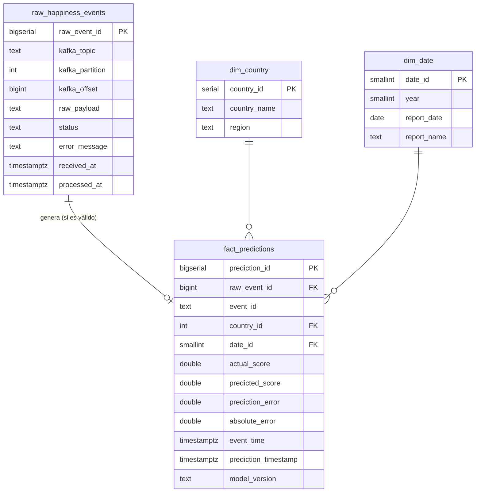

# Happiness Streaming ETL

Pipeline ETL en streaming con Apache Kafka y un modelo de regresión preentrenado que predice en tiempo real el puntaje de felicidad (World Happiness, datos 2015-2019).

Curso: ETL (G01) - Workshop-3, Universidad Autónoma de Occidente.

## Descripción del proyecto

El proyecto tiene dos partes:

- **Parte A (offline):** perfilar los cinco archivos anuales de World Happiness, limpiarlos y armonizarlos en un solo dataset, y entrenar un modelo de regresión guardado como `model.pkl`.
- **Parte B (streaming):** un producer de Kafka publica cada registro como un evento; un consumer lo valida, predice el puntaje y guarda los eventos crudos y las predicciones en una base de datos que alimenta el dashboard.

## Arquitectura

_Pendiente (diagrama completo al final del proyecto)._

La Parte A es un paquete de Python (`src/happiness_etl/`) que ejecuta `main.py`:

```
data/raw/*.csv -> extract -> clean -> transform -> validate (compuerta de calidad) -> load -> data/processed/happiness_unified.csv
```

| Módulo | Responsabilidad |
|---|---|
| `config.py` | Rutas, años, nombres canónicos y mapa de columnas de cada año (única fuente de verdad) |
| `extract.py` | Leer los CSV originales tal como vienen |
| `clean.py` | Por año: nombres canónicos de columna, columna `year`, texto del país, tipos numéricos y duplicados exactos |
| `transform.py` | Entre años: unir, unificar nombres de país, interpolar valores faltantes y ordenar |
| `validate.py` | Compuerta de calidad antes de cargar y reconciliación después de cargar |
| `load.py` | Escritura atómica del CSV y lectura con tipos del dataset unificado |

Los pasos intermedios se pasan en memoria; solo el dataset final ya validado se escribe en disco, porque el notebook de entrenamiento y el producer de Kafka lo leen desde procesos separados. El archivo no se versiona: se regenera con `main.py`.

## Decisiones de limpieza de datos

El perfilado de calidad está en [`notebooks/profiling.ipynb`](notebooks/profiling.ipynb) (Paso 1 del taller). Decisiones principales:

| Hallazgo | Decisión |
|---|---|
| Un mismo concepto tiene hasta tres nombres de columna según el año | Se asigna a cada año los nombres canónicos (`config.COLUMN_MAP_BY_YEAR`) |
| Los archivos no traen columna de año | Se agrega `year` a partir del archivo de origen |
| Columnas que no se usan: rankings, `Region`, error estándar, intervalos de confianza, *whiskers* y `Dystopia Residual` | Se descartan. El ranking y el residual dependen del puntaje, así que usarlos sería fuga del target |
| Un único valor faltante: `corruption` de United Arab Emirates en 2018 | Interpolación lineal dentro del país (promedio de 2017 y 2019, 0.253). Solo entre años observados, sin extrapolar; queda registrado como aviso en el log |
| Seis países se escriben distinto según el año (p. ej. `Trinidad & Tobago`) | Se usa el nombre que aparece en más años (`config.COUNTRY_NAME_MAP`): 170 nombres pasan a ser 164 países |
| Un cero por variable y año, y 102 outliers según IQR | Se conservan: los ceros son el mínimo de cada escala y los outliers son valores plausibles, no errores |
| `family` y `health` cambian de escala entre años | No se modifica en la limpieza; se estudia en el EDA del modelo |

La compuerta de calidad (`validate.py`) detiene el pipeline antes de escribir si falla alguna regla y reporta todas las fallas juntas: esquema exacto, sin nulos, país no vacío, año entre 2015 y 2019, variables no negativas, puntaje entre 0 y 10 y par (país, año) único. Resultado: 782 filas, 164 países y ningún valor faltante.

## Decisiones de ingeniería de características

_Pendiente._

## Pipeline de Kafka y contrato del evento

_Pendiente._

## Esquema de la base de datos

PostgreSQL con un esquema en estrella: una tabla de hechos con las predicciones, dos dimensiones y una tabla de staging para la trazabilidad.

| Archivo | Contenido |
|---|---|
| `sql/create_tables.sql` | Tablas, llaves, restricciones e índices (idempotente). |
| `sql/seed_dimensions.sql` | Carga inicial de `dim_country` (164 países con su región) y `dim_date` (2015-2019). |
| `docs/diagrams/dimensional_model.dbml` | Diagrama del modelo para [dbdiagram.io](https://dbdiagram.io). |



| Tabla | Grano | Decisiones |
|---|---|---|
| `raw_happiness_events` | Un mensaje de Kafka | Staging, no dimensión. El consumer inserta **antes** de validar; `raw_payload` es el texto exacto (conserva incluso un JSON mal formado). `status`: `RECEIVED` (guardado, aún sin procesar) y los cuatro del taller: `VALID`, `INVALID_SCHEMA`, `INVALID_VALUES`, `PREDICTION_ERROR`. Un estado inválido exige `error_message`. `(topic, partition, offset)` es único, así una reentrega de Kafka no duplica filas. |
| `fact_predictions` | Una predicción por evento válido | `raw_event_id` es único y enlaza cada predicción con el mensaje que la originó. `prediction_error = predicted_score − actual_score` (con signo: positivo = sobreestima) y `absolute_error` son **columnas generadas**: las calcula PostgreSQL, por lo que nunca quedan inconsistentes. `model_version` identifica el modelo que predijo. |
| `dim_country` | Un país | `region` viene de la columna Region de 2015-2016; Gambia (solo aparece en 2019) se asignó a mano a Sub-Saharan Africa. Un país nuevo se inserta con región vacía en lugar de rechazar el evento. |
| `dim_date` | Un reporte anual | `date_id` = año. Es el eje temporal del análisis (tendencia del error por año). El momento del streaming queda en `event_time` y `prediction_timestamp`: todos los eventos se emiten el mismo día, así que una dimensión diaria no aportaría. |

## Dashboard

_Pendiente._

## Instrucciones de ejecución

_Parcial: por ahora solo la Parte A._

```bash
python3.12 -m venv .venv
source .venv/bin/activate
pip install -r requirements.txt

python -m happiness_etl.main   # genera data/processed/happiness_unified.csv
python -m pytest -q            # ejecuta las pruebas
```

`main.py` termina con código 1 y lista las reglas incumplidas si la compuerta de calidad detiene el pipeline.
